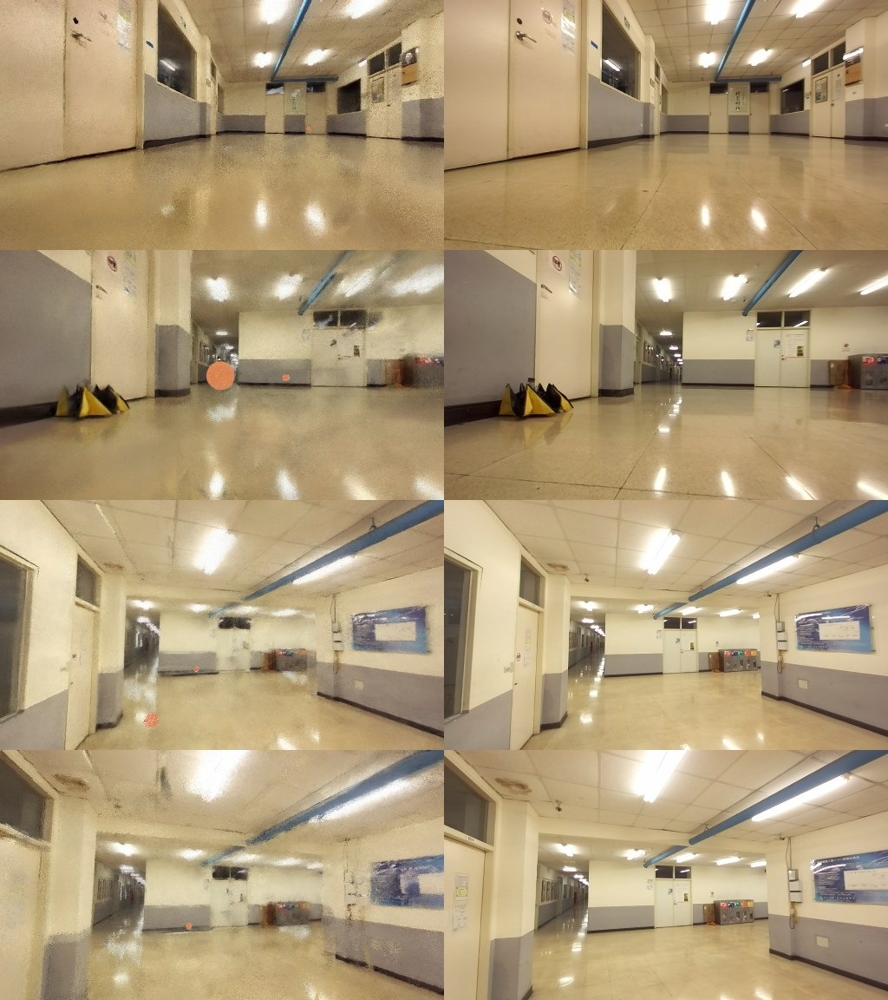
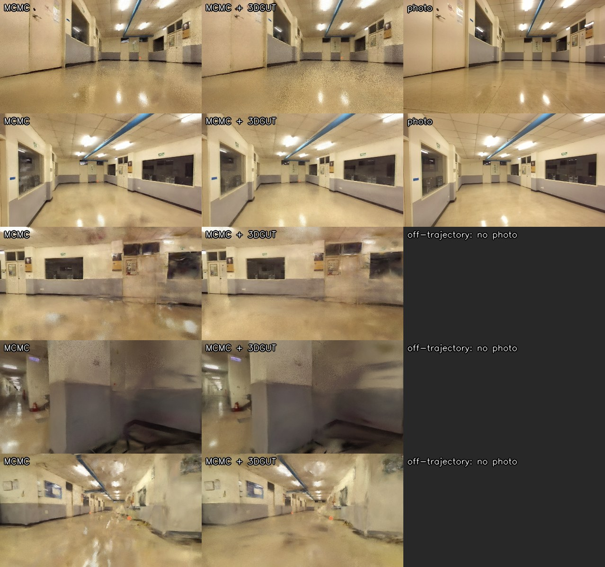

**English** | [中文](README.zh-TW.md)

# EB Corridor — Gaussian Splatting from ROS 2 Bags

3D Gaussian Splatting reconstruction of an indoor corridor, trained from two ROS 2 (Jazzy) recordings
(`EB_try_h1`, `EB_try_h3`) captured by a ground robot carrying a ZED stereo camera, a Livox LiDAR and a
RealSense T265. The two recordings are fused into a single scene using the ZED VIO poses, a cross-session
alignment and a joint COLMAP bundle adjustment, then trained with [gsplat](https://github.com/nerfstudio-project/gsplat).


## Results

All models are evaluated on held-out frames (every 8th image). Trained models (`.ply` / `.pt`) and
fly-through videos are attached to the [Releases](../../releases) page (v1.0: default strategy,
v1.1: MCMC, v1.2: collision map / LiDAR point cloud, v1.3: splat USD for Isaac Sim, v1.4: MCMC + 3DGUT).

| Model | Images | Steps | PSNR ↑ | SSIM ↑ | LPIPS ↓ | #Gaussians |
|---|---|---|---|---|---|---|
| h1 only (baseline) | 512 | 30k | 26.67 | 0.883 | 0.378 | 0.56 M |
| Joint h1+h3, 2 fps | 930 | 30k | 27.38 | 0.905 | 0.324 | 0.62 M |
| Joint h1+h3, 4 fps | 1791 | 50k | 28.34 | 0.909 | 0.313 | 0.81 M |
| **Joint h1+h3, 4 fps, MCMC** | **1791** | **50k** | **30.50** | **0.926** | **0.275** | **1.00 M** |

> The test sets of the first three rows differ (they are drawn from different frame sets), so those numbers
> are only roughly comparable. The two 4 fps rows share the **same** test set and are directly comparable.
> The side-by-side comparison below uses near-identical viewpoints (≤ 0.07 s apart).

**Same-view comparison** — left: ground truth · middle: joint 2 fps · right: joint 4 fps


The 4 fps model is sharper in most views (fire cabinet, stairs, railings), but with the default strategy a
large floater appears in front of the camera near the beginning of `h1` (row 1), plus a band artifact on the
floor (row 2). A near plane (0.15 m) did **not** fix it. **The MCMC model below removes both.**

### Ablation (4 fps data, 7k steps, one flag changed at a time)

| Run | Flag | PSNR | SSIM | LPIPS |
|---|---|---|---|---|
| A | default | **25.23** | **0.885** | **0.398** |
| B | `--pose-opt` | 25.11 | 0.883 | 0.403 |
| C | `--app-opt` | 24.89 | 0.883 | 0.405 |
| D | `--strategy.absgrad --strategy.grow-grad2d 6e-4` | 22.59 | 0.859 | 0.457 |

A first "improved" run that combined `pose_opt + app_opt + absgrad + bilateral grid` collapsed
(PSNR 20.7 at 7k, large floaters — see `assets/failed_absgrad_combo_7k.jpg`). The ablation shows **absgrad
is the culprit** on this low-texture scene; `pose_opt` / `app_opt` bring no gain because the joint BA poses
are already accurate and exposure is consistent across the two sessions. The bilateral grid was dropped for
speed: its TV regulariser runs over every image's grid each step (~190 ms/step with 1791 images).

## MCMC (3DGS-MCMC)

Same data, test set and 50k steps as the 4 fps default run; only the densification strategy changes
(`simple_trainer.py mcmc`, `cap_max` 1 M) — **with `--opacity-reg 0.001`** (default 0.01).

**Same views** — left: ground truth · middle: default strategy · right: MCMC


MCMC gains **+2.2 dB PSNR** (28.34 → 30.50) and removes the floater in front of the camera at the start of
`h1` (row 1) and the floor band (row 2); walls, stairs and whiteboards are also sharper.

### Why gsplat's default MCMC settings collapse on this scene

With the default `opacity_reg 0.01`, training collapses after ~4k steps: renders turn into a single colour
(`assets/failed_mcmc_default_7k.jpg`) and speed drops from ~30 it/s to 1.4 s/it. The 7k checkpoint shows
**94 % of the Gaussians "dead"** (opacity < 0.005) and their centres drifted far out of the scene (median
~57 m, max ~9 km, for a building that is a few tens of metres across). The opacity regulariser pushes most
Gaussians below the relocation threshold; MCMC then keeps relocating them and injecting position noise
(which is largest for low-opacity Gaussians), and the chain runs away. The relocation CUDA kernel was checked
against the closed form of the paper (max error 1e-7), so it is not a hardware/compilation issue on the
RTX 5060 Ti (sm_120).

Ablation at 7k steps (50k LR schedule, stopped after the 7k evaluation):

| Run | Change vs default MCMC | PSNR | SSIM | LPIPS | |
|---|---|---|---|---|---|
| N1 | *default strategy* + `--near-plane 0.02` (≈ 0.15 m) | 24.08 | 0.866 | 0.469 | reference |
| M1 | `--near-plane 0.02` | 14.87 | 0.779 | 0.675 | collapsed |
| M2 | `--strategy.noise-lr 5e4` (10× lower) | 15.07 | 0.776 | 0.673 | collapsed later (~6k) |
| **M3** | **`--opacity-reg 0.001` (10× lower)** | **24.57** | **0.871** | 0.476 | **stable** |
| M4 | default MCMC on `h1` only (2 fps) | 15.94 | 0.762 | 0.665 | collapsed |

M4 shows that the collapse is not caused by fusing the two sessions.

## Collision map (for simulation)

A metric **3D collision mesh** built from the Livox Mid-360 LiDAR in the bags (not from the Gaussians:
3DGS geometry has fake surfaces under the reflective floor and floaters near white walls). It lives in a
gravity-levelled frame with the **floor at z = 0**, and lines up with the Gaussian splatting scene through
the provided transforms, so the 3DGS model can be used as the visual and this mesh as the collider.

| File | Description |
|---|---|
| [`collision/collision_mesh.usd`](collision/collision_mesh.usd) | **Isaac Sim / Isaac Lab** static collider (Z-up, metres, `UsdPhysics.CollisionAPI`, exact triangle mesh), 397 k triangles |
| [`collision/collision_mesh.obj`](collision/collision_mesh.obj) | Same mesh as OBJ (Gazebo, MuJoCo, Blender, …) |
| [`collision/floor.obj`](collision/floor.obj) | Flat floor grid at z = 0 (already included in the two files above) |
| [`collision/T_gsplat_from_sim.txt`](collision/T_gsplat_from_sim.txt) | 4×4 similarity, `x_gsplat = T @ x_sim` — maps the collision frame into the frame of the 3DGS `.ply` / checkpoints |
| [`collision/T_sim_from_ba.txt`](collision/T_sim_from_ba.txt) | 4×4, COLMAP/BA world (metric) → collision frame |
| `collision/T_camlink_livox_{h1,h3}.txt` | Estimated Livox → `zed_camera_link` extrinsics per session |
| [`collision/stats.json`](collision/stats.json) | All numbers below |
| Release v1.2: `lidar_map_2cm.ply`, `collision_mesh_full.ply`, `collision_mesh_nofloor.obj` | 12 M-point fused LiDAR cloud, 13.7 M-triangle full-resolution mesh, mesh without the floor grid |

To place the Gaussian scene in the simulator, apply `inv(T_gsplat_from_sim)` to the 3DGS `.ply` (it is a
similarity: rotation + translation + scale 0.137). Verified: camera centres mapped through the transforms
match gsplat's own cameras to 7·10⁻⁷ m.


*Left: obstacles 0.3–1.5 m above the floor (top view). Right: 6 m-wide side slab — floor flat at z = 0,
ceiling level at ~2.7 m, doors/windows visible.*


*Collision mesh projected into real camera frames with the camera poses (colour = depth). Walls, ceiling,
doors and stairs line up with the images, i.e. the mesh is registered to the camera / 3DGS geometry.*

### How it is built (`scripts/build_lidar_map.py`)

1. **LiDAR extraction** — `/livox/lidar` (CustomMsg) parsed straight from CDR bytes (87 M points, < 5 s per bag).
2. **Extrinsic** — `tf_static` has no Livox transform, so `calib_lidar.py` estimates it: yaw grid search against
   the SfM points, then iterative point-to-plane ICP of LiDAR submaps. **Per session**, because the rigs differ:
   *h3 was recorded with the sensors ~1.2 m higher than h1* (h1 Livox is 10.5 cm above the floor).
3. **Poses** — ZED VIO (30 Hz) corrected by the joint-BA poses (interpolated per image), per-point deskew.
4. **Levelling** — the BA world is tilted 2.78° (planar camera paths, ZED map frame not gravity aligned);
   levelled with the h1 camera-path plane.
5. **Clean-up** — robot body/mount points (sensor-frame voxels occupied in > 50 % of a session's scans,
   0.8 M points); **mirror returns** below the shiny floor (1.6 M); **moving objects** (the operator walking
   next to the robot) by per-session free-space carving within 1.5 m of the path (2.9 M).
6. **Registration** — h3 → h1 ICP (overlap within 10 cm 75.4 % → 79.9 %, RMSE 4.1 → 3.8 cm), then LiDAR →
   SfM ICP (SfM points within 5 cm of the LiDAR map 37 % → 52 %, within 10 cm 60 % → 69 %).
7. **Mesh** — Poisson (depth 11) trimmed to observed areas, decimated to ~383 k triangles, plus a flat
   0.5 m floor grid (the 9–10 cm high Mid-360 sees the shiny floor only at grazing angles, so floor returns
   are too sparse to mesh); USD via `mesh_to_usd.py` (needs `pxr`, e.g. the Isaac Lab env).

### Limitations

- **Glass** (windows, glass doors) is mostly invisible to LiDAR, so the mesh may be open there.
- Doors are frozen in the state they were in during recording.
- The floor is an idealised plane; ramps/steps on the floor are not modelled (stairs are, from LiDAR).
- Some walls still show a few-cm double surface from residual misalignment; fine for collision,
  not for precise measurement.
- A faint ghost of the operator may remain where they stood still for a long time.

## Isaac Lab example: Gaussian splat visual + collision mesh

[`isaac/`](isaac/) loads the corridor in Isaac Lab with the **MCMC Gaussian splat as the visual** (rendered
natively by Isaac Sim as a USD `ParticleField3DGaussianSplat`) and the **LiDAR mesh as the collider**, in
one frame (metres, Z up, floor at z = 0). Tested with Isaac Sim 6.1 and Isaac Lab 3.0 (EA) on an RTX 5060 Ti.

```bash
# 1) get the splat USD (237 MB) from Release v1.3 into isaac/
gh release download v1.3 -R asdfut/eb-gaussian-splatting -p corridor_splat_gsframe.usdc -D isaac

# 2) run (inside the Isaac Lab python environment)
cd isaac
python load_corridor_scene.py --viz kit              # interactive window
python load_corridor_scene.py --save_dir renders/    # headless: collision check + RGB renders
#   --show_collision  draw the collision mesh   --render_frames N  RTX accumulation per view (default 64)
#   --num_objects N   balls dropped on the floor --num_views N     views rendered per recording
#   --scene corridor_scene_ut.usda  use the 3DGUT model (download corridor_splat_ut_gsframe.usdc from v1.4)
#   --views my_views.json           render your own eye/target camera poses
```

The script drops balls along the robot path and checks they come to rest on the floor, then renders
camera views at recorded ZED poses (same intrinsics). Expected output:

```
[corridor] gaussian splat prims: ['/World/Corridor/Splat/gaussians'] (1000000 splats) | rtx/rendermode = RealTimePathTracing
[corridor] collision check: 10/10 balls resting on the floor (z ~ 0.1 m)
```



*Left: Isaac Sim render (splat + red test balls resting on the collision floor). Right: the real photo
from the same pose. Rendered with `--render_frames 256`.*

| File | Description |
|---|---|
| `isaac/corridor_scene.usda` | Scene: `/Corridor/Collision` (→ `../collision/collision_mesh.usd`, invisible but colliding) + `/Corridor/Splat` (Xform with `inv(T_gsplat_from_sim)`, scale 7.29) / `gaussians` (→ splat USD) |
| `isaac/corridor_scene.usda.views.json` | Recorded camera poses (eye / target) in the scene frame, used for spawn points and renders |
| `isaac/load_corridor_scene.py` | Isaac Lab loader / collision check / renderer |
| `isaac/make_scene_usd.py` | Rebuilds `corridor_scene.usda` (run with an interpreter that has `pxr`) |
| Release v1.3: `corridor_splat_gsframe.usdc` | MCMC model (1 M Gaussians) converted with NVIDIA's `omni.kit.converter.gsplat`, in gsplat's normalized frame |
| `isaac/corridor_scene_ut.usda` + Release v1.4: `corridor_splat_ut_gsframe.usdc` | Same scene with the MCMC + 3DGUT model (see the experiment below) |

**Things that matter (each one cost a debugging round):**

- Gaussians are drawn only in **RTX Real-Time 2.0** (`--/rtx/rendermode=RealTimePathTracing`); Isaac Lab's default
  `RaytracedLighting` shows nothing. Isaac Sim's NuRec code also requires `--/renderer/multiGpu/enabled=false`.
  The script passes both through `--kit_args`.
- In the scene USD the splat reference sits on a **typeless child prim**. Putting it directly on the `Xform` that
  carries the transform makes the local `Xform` type win over `ParticleField3DGaussianSplat`, and nothing renders.
- The splat is placed with a transform instead of baking it into the data, which would also require rotating
  every spherical-harmonics coefficient.
- The ZED principal point is 7 px below the image centre, but **Omniverse ignores camera aperture offsets**
  (Isaac Lab warns about it). The loader renders 14 rows taller with a centred principal point and crops the
  top 720 rows; this raised PSNR against the real photos by ~1.3 dB.
- Path-traced splats are grainier than gsplat's rasterizer; raise `--render_frames` for cleaner images.
- The floor plane is flat, while the reconstruction drifts slightly in height: the splat floor is within ~8 cm of
  z = 0 almost everywhere, and up to ~15 cm below it near the start of `h1`.

### Experiment: training with 3DGUT for Isaac's ray-traced renderer

Isaac Sim evaluates Gaussians in 3D along rays, while gsplat trains by default with 2D-projected
rasterization. To make training match the renderer, the MCMC model was retrained with gsplat's 3DGUT mode
(`--with-ut --with-eval3d`, everything else identical; `--disable-video` is required because gsplat's 3D
evaluation only supports RGB, so the RGB+depth trajectory render aborts).

| 4 fps, MCMC, 50k steps | gsplat eval PSNR / SSIM / LPIPS | Isaac render vs photo, 8 recorded views: PSNR / SSIM |
|---|---|---|
| MCMC (v1.1) | **30.50** / 0.926 / **0.275** | **23.88** / **0.741** |
| MCMC + 3DGUT (v1.4) | 30.28 / 0.925 / 0.279 | 23.47 / 0.729 |



*Isaac Sim renders (256 frames). Rows 1–2: recorded views with the photo. Rows 3–5: off-trajectory views
(0.6 m high, turned ±60° towards the walls), where no photo exists.*

**Result: no clear gain.** 3DGUT is on par in gsplat and 0.4 dB lower in Isaac at recorded views; off the
trajectory it is somewhat cleaner in some views (rows 3 and 5) and shows more floor speckle in others
(row 1). The default scene therefore keeps the MCMC model; the 3DGUT one is available as
`isaac/corridor_scene_ut.usda` (splat USD in Release v1.4). The remaining gap to gsplat's own renderer
(~24 vs ~30 dB) comes from Isaac's path-traced Gaussian rendering (noise / speckle); blur in
off-trajectory views comes from the data (only two camera heights, all looking along the corridor) and
needs more coverage or geometric supervision (e.g. LiDAR depth), not a different renderer.

To convert another `.ply` (standard 3DGS layout, e.g. any gsplat export):

```bash
PYTHONPATH=<isaacsim>/extscache/omni.kit.converter.gsplat-*/pip_prebundle \
  python -m usd_convert_gsplat -i point_cloud.ply -o splat.usdc --up-axis Z
```

## Pipeline

```
ROS 2 bag (.mcap)
 ├─ /zed/zed_node/rgb/color/rect/image/compressed  → extract.py: sharpest frame per 1/fps window
 ├─ /zed/zed_node/rgb/color/rect/camera_info       → fixed PINHOLE intrinsics (fx≈528, 1280×720, rectified)
 ├─ /zed/zed_node/pose + /tf_static                → zed_to_colmap.py: camera_link → left optical frame poses
 │
 ├─ COLMAP SIFT + sequential matching (per session)
 ├─ cross-session alignment: register h3 into h1 (image_registrator) → align.py: RANSAC rigid fit
 ├─ spatial_pairs.py: match nearby h1/h3 views using the aligned poses
 ├─ point_triangulator → bundle_adjuster → re-triangulate → BA → point_filtering
 └─ gsplat simple_trainer.py
```

Why ZED poses instead of plain COLMAP SfM: on the corridor (reflective floor, textureless walls) COLMAP's
mapper split `h1` into 4 disconnected models (287/81/104/12 of 512 images). Triangulating with the ZED VIO
poses registered all images with 0.97 px reprojection error.

| Sparse model | Images | Points | Mean track length | Reproj. error |
|---|---|---|---|---|
| h1 only (ZED poses) | 512 | 37.8 k | 6.9 | 0.97 px |
| Joint 2 fps | 930 | 79.3 k | 6.7 | 0.64 px |
| Joint 4 fps | 1791 | 136.1 k | 8.7 | 0.66 px |

Cross-session alignment: 367 / 418 `h3` frames registered into `h1`; RANSAC rigid fit with 250 inliers
(median 18 cm / 2.5° residual due to VIO drift), corrected by the joint BA (median pose change 9 cm).
The transform is in [`results/alignment/T_h1_h3.txt`](results/alignment/T_h1_h3.txt).

## Reproduce

Environment: RTX 5060 Ti 16 GB · PyTorch 2.9.1 + CUDA 12.8 · gsplat 1.5.3 · COLMAP 3.13 (CUDA) ·
`pip install mcap mcap-ros2-support`. Activate the conda env before training (gsplat JIT needs `CUDA_HOME`).

```bash
# Joint 4 fps scene (bag paths are set at the top of the script)
scripts/run_joint.sh 4 joint4 --max-steps 50000 --eval-steps 7000 30000 50000 \
  --save-steps 30000 50000 --ply-steps 30000 50000 --strategy.refine-stop-iter 25000

# MCMC on the same data (after run_joint.sh has built data/joint4_gs)
python gsplat/examples/simple_trainer.py mcmc --data-dir data/joint4_gs --data-factor 1 \
  --result-dir results/joint4_mcmc --disable-viewer --save-ply --max-steps 50000 \
  --eval-steps 7000 30000 50000 --save-steps 30000 50000 --ply-steps 30000 50000 \
  --strategy.cap-max 1000000 --opacity-reg 0.001

# Single bag
scripts/run_scene.sh path/to/bag.mcap h1 2
```

`run_joint.sh` reuses the alignment `T_h1_h3.npy` from the 2 fps run (same bags, same map frames).

View a trained model:

```bash
cd gsplat/examples
python simple_viewer.py --ckpt ckpt_49999_rank0.pt --port 8080   # then open http://localhost:8080
```

The `.ply` files use the standard 3DGS format and open in viewers such as SuperSplat.

## Repository layout

```
scripts/            pipeline scripts (extraction, ZED→COLMAP, alignment, pairing, training)
results/
  joint_2fps/       cfg.yml + val/train stats
  joint_4fps/       cfg.yml + val/train stats
  joint_4fps_mcmc/  cfg.yml + val/train stats (MCMC, best model)
  joint_4fps_mcmc_ut/ cfg.yml + val/train stats (MCMC + 3DGUT)
  ablation_4fps_7k/ A–D ablation configs and stats
  ablation_mcmc_7k/ M1–M4, N1 MCMC stability ablation
  alignment/        h3→h1 rigid transform
collision/          collision mesh (USD / OBJ), floor, frame transforms, stats
isaac/              Isaac Lab scene (splat visual + collision) and loader
assets/             figures used in this README
```
