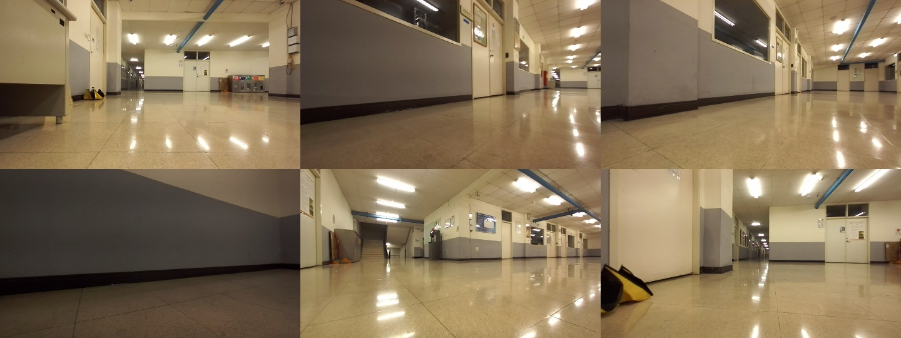
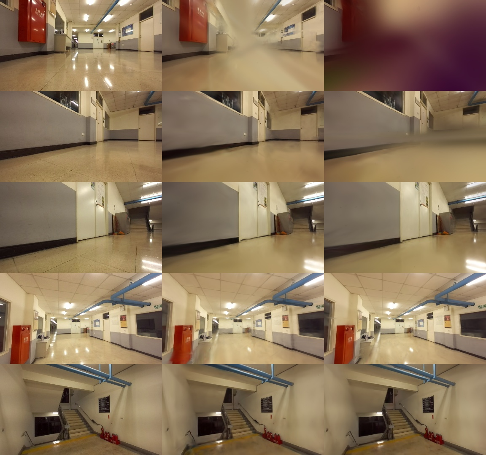
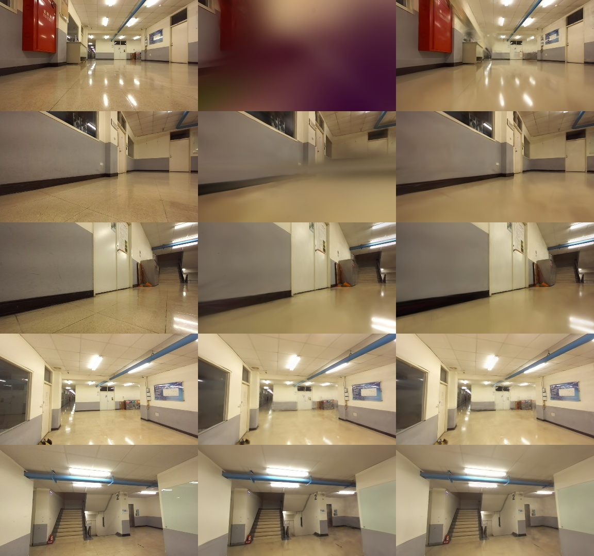
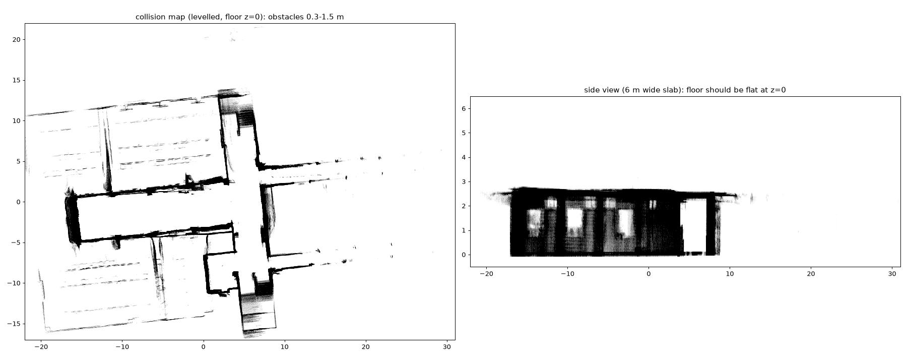
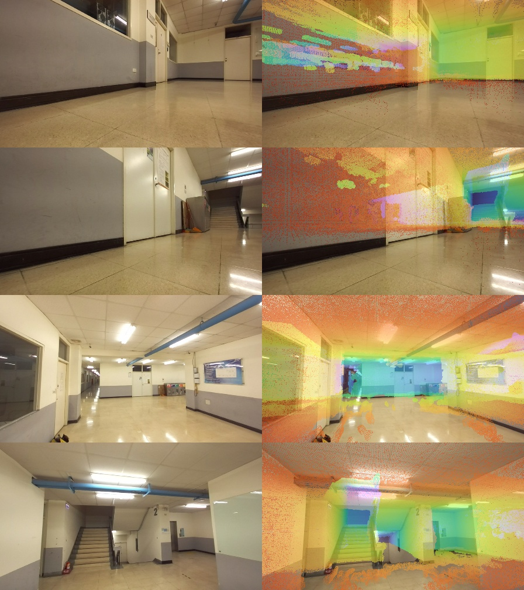

[English](README.md) | **中文**

# EB 走廊 — 由 ROS 2 Bag 訓練高斯潑濺

用兩段 ROS 2（Jazzy）錄影（`EB_try_h1`、`EB_try_h3`）重建室內走廊的 3D Gaussian Splatting 模型。資料由搭載
ZED 雙目相機、Livox LiDAR 與 RealSense T265 的地面機器人錄製。兩段錄影透過 ZED VIO 位姿、跨錄影對齊與
COLMAP 聯合光束法平差（bundle adjustment）融合成同一個場景，再用 [gsplat](https://github.com/nerfstudio-project/gsplat) 訓練。



## 結果

所有模型都在保留的測試影像（每 8 張取 1 張）上評估。訓練好的模型（`.ply` / `.pt`）與漫遊影片放在
[Releases](../../releases) 頁面（v1.0：預設策略；v1.1：MCMC；v1.2：碰撞地圖 / LiDAR 點雲）。

| 模型 | 影像數 | 步數 | PSNR ↑ | SSIM ↑ | LPIPS ↓ | 高斯數 |
|---|---|---|---|---|---|---|
| 只用 h1（基準） | 512 | 30k | 26.67 | 0.883 | 0.378 | 56 萬 |
| h1+h3 合併，2 fps | 930 | 30k | 27.38 | 0.905 | 0.324 | 62 萬 |
| h1+h3 合併，4 fps | 1791 | 50k | 28.34 | 0.909 | 0.313 | 81 萬 |
| **h1+h3 合併，4 fps，MCMC** | **1791** | **50k** | **30.50** | **0.926** | **0.275** | **100 萬** |

> 前三列的測試集不同（取自不同的抽幀集合），數字只能大致比較；兩列 4 fps 使用**相同**的測試集，可以
> 直接比較。下面的並排比較使用幾乎相同的視角（時間差 ≤ 0.07 秒）。

**同視角比較** — 左：真實影像 · 中：合併 2 fps · 右：合併 4 fps



4 fps 模型在大部分視角更清晰（消防箱、樓梯、扶手），但使用預設策略時，`h1` 開頭附近的視角鏡頭正前方
出現一大塊漂浮物（第 1 列），地板也有一條帶狀假影（第 2 列）。設定 near plane（0.15 m）**沒有**解決。
**下面的 MCMC 模型把兩者都消除了。**

## MCMC（3DGS-MCMC）

資料、測試集與步數（50k）都和 4 fps 預設策略那一輪相同，只換掉高斯增減策略（`simple_trainer.py mcmc`，
`cap_max` 100 萬），並**加上 `--opacity-reg 0.001`**（預設是 0.01）。

**同視角比較** — 左：真實影像 · 中：預設策略 · 右：MCMC



MCMC 讓 **PSNR 提高 2.2 dB**（28.34 → 30.50），消除了 `h1` 開頭鏡頭前的漂浮物（第 1 列）和地板帶狀假影
（第 2 列）；牆面、樓梯與白板也更清晰。

### 為什麼 gsplat 預設的 MCMC 參數在這個場景會崩壞

使用預設的 `opacity_reg 0.01` 時，訓練約在第 4k 步後崩壞：渲染結果變成單一顏色
（`assets/failed_mcmc_default_7k.jpg`），速度也從約 30 it/s 掉到 1.4 秒一步。檢查第 7k 步的 checkpoint：
**94% 的高斯已經「死亡」**（不透明度 < 0.005），而且中心點漂離場景（中位數約 57 m、最遠約 9 km，但建築本身
只有幾十公尺大）。不透明度正則把大多數高斯壓到重新定位門檻以下；MCMC 不斷重新定位它們並注入位置雜訊
（不透明度越低雜訊越大），最後整個鏈失控。重新定位用的 CUDA kernel 已和論文的封閉解比對過（最大誤差
1e-7），所以不是 RTX 5060 Ti（sm_120）的硬體或編譯問題。

7k 步消融實驗（沿用 50k 的學習率排程，第 7k 步評估後停止）：

| 實驗 | 相對預設 MCMC 的改動 | PSNR | SSIM | LPIPS | |
|---|---|---|---|---|---|
| N1 | *預設策略* + `--near-plane 0.02`（約 0.15 m） | 24.08 | 0.866 | 0.469 | 對照組 |
| M1 | `--near-plane 0.02` | 14.87 | 0.779 | 0.675 | 崩壞 |
| M2 | `--strategy.noise-lr 5e4`（降 10 倍） | 15.07 | 0.776 | 0.673 | 較晚崩壞（約 6k） |
| **M3** | **`--opacity-reg 0.001`（降 10 倍）** | **24.57** | **0.871** | 0.476 | **穩定** |
| M4 | 只用 `h1`（2 fps）的預設 MCMC | 15.94 | 0.762 | 0.665 | 崩壞 |

M4 顯示崩壞和合併兩段錄影無關。

### 消融實驗（4 fps 資料、7k 步、每次只改一個參數）

| 實驗 | 參數 | PSNR | SSIM | LPIPS |
|---|---|---|---|---|
| A | 預設 | **25.23** | **0.885** | **0.398** |
| B | `--pose-opt` | 25.11 | 0.883 | 0.403 |
| C | `--app-opt` | 24.89 | 0.883 | 0.405 |
| D | `--strategy.absgrad --strategy.grow-grad2d 6e-4` | 22.59 | 0.859 | 0.457 |

第一次「改進版」同時開了 `pose_opt + app_opt + absgrad + bilateral grid`，結果崩壞（7k 步 PSNR 20.7、
大量漂浮物，見 `assets/failed_absgrad_combo_7k.jpg`）。消融實驗顯示，在這個低紋理場景中 **absgrad 是元兇**；
`pose_opt` / `app_opt` 沒有幫助，因為聯合 BA 後的位姿已經很準，兩段錄影的曝光也一致。bilateral grid 因為
速度被拿掉：它的 TV 正則項每一步都會對全部影像的網格計算（1791 張時約 190 ms/步）。

## 碰撞地圖（給模擬用）

用 bag 裡的 Livox Mid-360 LiDAR 建立的公制 **3D 碰撞網格**。沒有從高斯模型取幾何，因為 3DGS 在反光地板
下方會有假表面，白牆附近也有漂浮物。網格位在重力校正後的座標系，**地板在 z = 0**，並且透過附上的轉換矩陣
和高斯潑濺場景對齊，因此可以用 3DGS 模型當外觀、用這個網格當碰撞體。

| 檔案 | 說明 |
|---|---|
| [`collision/collision_mesh.usd`](collision/collision_mesh.usd) | **Isaac Sim / Isaac Lab** 靜態碰撞體（Z 軸朝上、單位公尺、`UsdPhysics.CollisionAPI`、精確三角網格），39.7 萬個三角形 |
| [`collision/collision_mesh.obj`](collision/collision_mesh.obj) | 同一個網格的 OBJ 版本（Gazebo、MuJoCo、Blender 等） |
| [`collision/floor.obj`](collision/floor.obj) | z = 0 的平面地板網格（上面兩個檔案已經包含） |
| [`collision/T_gsplat_from_sim.txt`](collision/T_gsplat_from_sim.txt) | 4×4 相似轉換，`x_gsplat = T @ x_sim`：把碰撞座標系轉到 3DGS `.ply` / checkpoint 的座標系 |
| [`collision/T_sim_from_ba.txt`](collision/T_sim_from_ba.txt) | 4×4，COLMAP/BA 世界座標（公制）→ 碰撞座標系 |
| `collision/T_camlink_livox_{h1,h3}.txt` | 各段錄影估出的 Livox → `zed_camera_link` 外參 |
| [`collision/stats.json`](collision/stats.json) | 下面所有數字的來源 |
| Release v1.2：`lidar_map_2cm.ply`、`collision_mesh_full.ply`、`collision_mesh_nofloor.obj` | 1200 萬點的融合 LiDAR 點雲、1370 萬個三角形的完整網格、沒有地板網格的版本 |

要把高斯場景放進模擬器，對 3DGS 的 `.ply` 套用 `inv(T_gsplat_from_sim)` 即可（這是相似轉換：旋轉 + 平移
+ 縮放 0.137）。已驗證：相機中心經過這些轉換後，和 gsplat 自己的相機位置相差 7·10⁻⁷ m。



*左：地板以上 0.3–1.5 m 的障礙物（俯視）。右：6 m 寬的側視切片——地板在 z = 0 是平的，天花板約在 2.7 m
也是水平的，可以看到門和窗戶。*



*用相機位姿把碰撞網格投影到真實影像上（顏色代表深度）。牆面、天花板、門和樓梯都和影像對齊，表示網格和
相機 / 3DGS 的幾何是對準的。*

### 建立方式（`scripts/build_lidar_map.py`）

1. **抽取 LiDAR**：`/livox/lidar`（CustomMsg）直接從 CDR 位元組解析（8700 萬點，每個 bag 不到 5 秒）。
2. **外參**：`tf_static` 裡沒有 Livox 的轉換，所以由 `calib_lidar.py` 估計：先對 SfM 點做 yaw 網格搜尋，
   再對 LiDAR 子地圖反覆做 point-to-plane ICP。**每段錄影分開估計**，因為兩次的安裝方式不同：
   *h3 錄影時感測器比 h1 高約 1.2 m*（h1 的 Livox 離地 10.5 cm）。
3. **位姿**：ZED VIO（30 Hz）加上聯合 BA 位姿的修正量（依影像時間內插），並逐點去畸變。
4. **水平校正**：BA 世界座標傾斜 2.78°（相機路徑是平面，但 ZED 的 map 座標系沒有對齊重力），
   用 h1 相機路徑的平面來校正。
5. **清理**：
   - 機器人本體和支架的點：在感測器座標中，被同一段錄影超過 50% 的掃描佔據的體素，共 80 萬點。
   - 反光地板下方的**鏡像點**，共 160 萬點。
   - **移動物體**（跟在機器人旁邊的操作人員）：每段錄影各自做射線雕刻，只雕刻路徑 1.5 m 內的範圍，
     共 290 萬點。
6. **對齊**：h3 → h1 ICP（10 cm 內重疊 75.4% → 79.9%，RMSE 4.1 → 3.8 cm），再做 LiDAR → SfM ICP
   （離 LiDAR 地圖 5 cm 內的 SfM 點 37% → 52%，10 cm 內 60% → 69%）。
7. **網格**：Poisson 重建（depth 11），剪掉沒有觀測的區域，簡化成約 38.3 萬個三角形，再加上 0.5 m 網格的
   平面地板。離地只有 9–10 cm 的 Mid-360 只能以掠射角看到反光地板，地板點太稀疏，無法直接建成網格。
   USD 由 `mesh_to_usd.py` 產生（需要 `pxr`，例如 Isaac Lab 的環境）。

### 限制

- **玻璃**（窗戶、玻璃門）LiDAR 大多看不到，網格在那些地方可能是開口。
- 門的狀態固定在錄影當時（開或關）。
- 地板是理想化的平面，地面上的坡道或台階沒有建模（樓梯有，來自 LiDAR）。
- 部分牆面因為殘留的對齊誤差，仍有幾公分的雙層表面；用於碰撞沒問題，但不適合精確量測。
- 操作人員長時間站著不動的地方，可能還留有淡淡的殘影。

## 流程

```
ROS 2 bag (.mcap)
 ├─ /zed/zed_node/rgb/color/rect/image/compressed  → extract.py：每 1/fps 秒挑最清晰的一張
 ├─ /zed/zed_node/rgb/color/rect/camera_info       → 固定 PINHOLE 內參（fx≈528，1280×720，已校正）
 ├─ /zed/zed_node/pose + /tf_static                → zed_to_colmap.py：camera_link → 左目光學座標位姿
 │
 ├─ COLMAP SIFT + 序列匹配（各段錄影）
 ├─ 跨錄影對齊：把 h3 註冊進 h1（image_registrator）→ align.py：RANSAC 剛體擬合
 ├─ spatial_pairs.py：用對齊後的位姿匹配空間上相近的 h1/h3 影像
 ├─ point_triangulator → bundle_adjuster → 重新三角化 → BA → point_filtering
 └─ gsplat simple_trainer.py
```

為什麼用 ZED 位姿而不是純 COLMAP SfM：走廊地板反光、牆面無紋理，COLMAP mapper 把 `h1` 切成 4 個互不相連的
模型（512 張中 287/81/104/12 張）。改用 ZED VIO 位姿三角化後，全部影像都註冊成功，重投影誤差 0.97 px。

| 稀疏模型 | 影像數 | 點數 | 平均 track 長度 | 重投影誤差 |
|---|---|---|---|---|
| 只用 h1（ZED 位姿） | 512 | 3.78 萬 | 6.9 | 0.97 px |
| 合併 2 fps | 930 | 7.93 萬 | 6.7 | 0.64 px |
| 合併 4 fps | 1791 | 13.61 萬 | 8.7 | 0.66 px |

跨錄影對齊：418 張 `h3` 中有 367 張註冊進 `h1`；RANSAC 剛體擬合得到 250 個內點（因 VIO 漂移，殘差中位數
18 cm / 2.5°），再由聯合 BA 修正（位姿修正量中位數 9 cm）。轉換矩陣見
[`results/alignment/T_h1_h3.txt`](results/alignment/T_h1_h3.txt)。

## 重現

環境：RTX 5060 Ti 16 GB · PyTorch 2.9.1 + CUDA 12.8 · gsplat 1.5.3 · COLMAP 3.13（CUDA）·
`pip install mcap mcap-ros2-support`。訓練前要先 activate conda 環境（gsplat 的 JIT 編譯需要 `CUDA_HOME`）。

```bash
# 合併 4 fps 場景（bag 路徑見腳本內設定）
scripts/run_joint.sh 4 joint4 --max-steps 50000 --eval-steps 7000 30000 50000 \
  --save-steps 30000 50000 --ply-steps 30000 50000 --strategy.refine-stop-iter 25000

# 在同一份資料上跑 MCMC（需先由 run_joint.sh 建好 data/joint4_gs）
python gsplat/examples/simple_trainer.py mcmc --data-dir data/joint4_gs --data-factor 1 \
  --result-dir results/joint4_mcmc --disable-viewer --save-ply --max-steps 50000 \
  --eval-steps 7000 30000 50000 --save-steps 30000 50000 --ply-steps 30000 50000 \
  --strategy.cap-max 1000000 --opacity-reg 0.001

# 單一 bag
scripts/run_scene.sh path/to/bag.mcap h1 2
```

`run_joint.sh` 會沿用 2 fps 那一輪算出的對齊矩陣 `T_h1_h3.npy`（同樣的 bag、同樣的 map 座標系）。

瀏覽訓練好的模型：

```bash
cd gsplat/examples
python simple_viewer.py --ckpt ckpt_49999_rank0.pt --port 8080   # 再用瀏覽器開 http://localhost:8080
```

`.ply` 是標準 3DGS 格式，可以用 SuperSplat 等工具開啟。

## 倉庫結構

```
scripts/            流程腳本（抽幀、ZED→COLMAP、對齊、配對、訓練）
results/
  joint_2fps/       cfg.yml 與驗證/訓練統計
  joint_4fps/       cfg.yml 與驗證/訓練統計
  joint_4fps_mcmc/  cfg.yml 與驗證/訓練統計（MCMC，最佳模型）
  ablation_4fps_7k/ A–D 消融實驗的設定與統計
  ablation_mcmc_7k/ M1–M4、N1 MCMC 穩定性消融實驗
  alignment/        h3→h1 剛體轉換
collision/          碰撞網格（USD / OBJ）、地板、座標轉換、統計
assets/             README 使用的圖片
```
